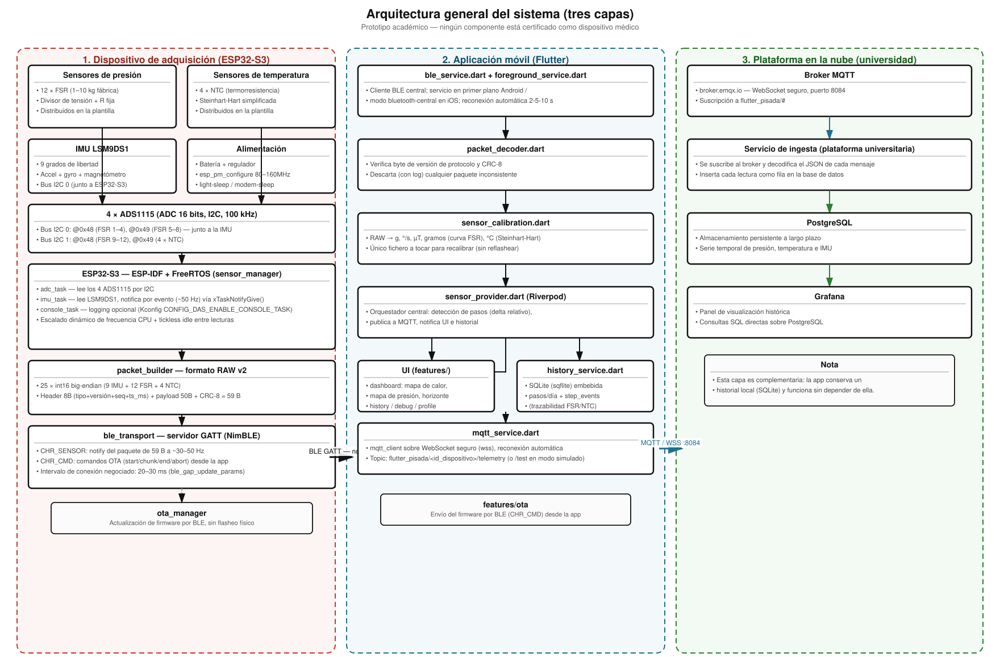
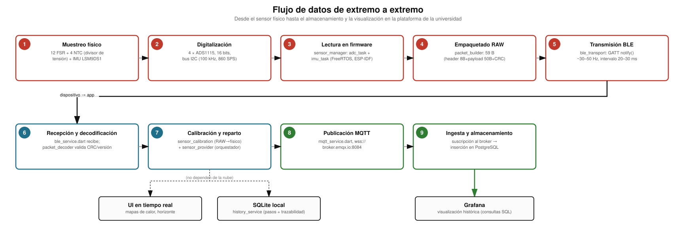
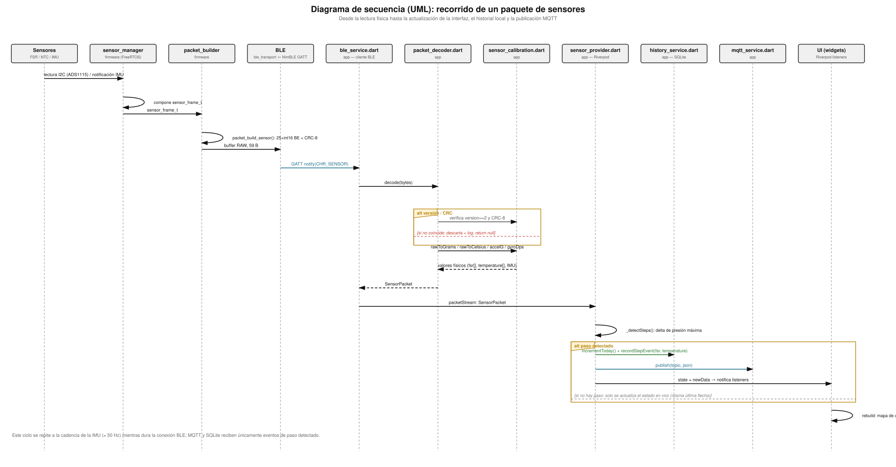
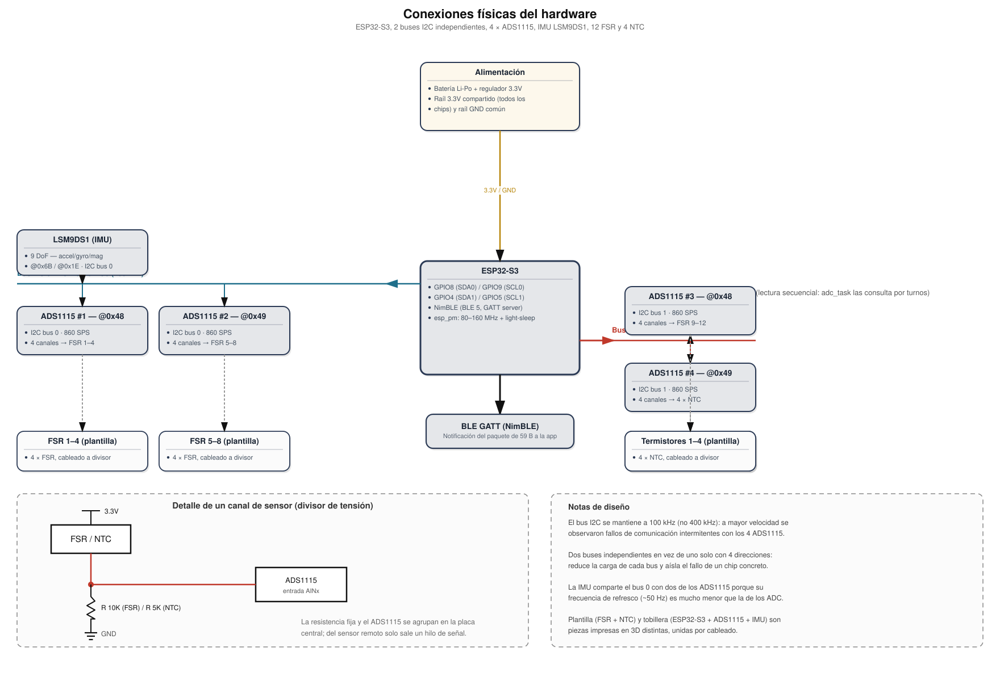
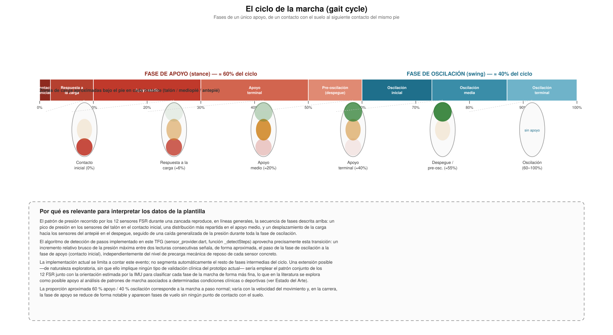

# Plantilla Sensorizada para el Análisis de la Pisada Dinámica

> **Documento de trabajo.** Esta es una versión en Markdown de la memoria del TFG, con **exactamente la misma estructura de capítulos y secciones** que `documentacion/Plantilla_TFG_251108/`. No sustituye a la memoria final en LaTeX (esa es la que se entregará): es el espacio para iterar sobre el contenido, generar y revisar imágenes/diagramas, y corregir el texto antes de trasladarlo al documento LaTeX definitivo. Las imágenes generadas aquí viven en `documentacion/memoria_md/img/` y están pensadas para poder incluirse tal cual (o regenerarse a partir de los scripts que las produjeron) en la versión LaTeX.

> ⚠️ **Aviso importante, válido para todo el documento.** El dispositivo descrito en este trabajo es un **prototipo académico**. No es un producto médico, no ha sido sometido a ningún proceso de certificación o marcado regulatorio (p. ej. marcado CE como producto sanitario, FDA u organismo equivalente), y no ha sido validado clínicamente. Cualquier mención a aplicaciones médicas, clínicas, deportivas o de rehabilitación a lo largo de este documento es **hipotética y exploratoria**, basada en lo que la literatura científica sugiere como posible para este tipo de tecnología en general — nunca una afirmación sobre lo que este prototipo concreto puede diagnosticar, tratar o sustituir. El objetivo del proyecto es demostrar que es técnicamente viable construir, con componentes de bajo coste, un sistema portátil de este tipo, no ofrecer una herramienta lista para uso clínico o profesional.

**Grado:** Doble Grado en Ingeniería de Computadores y Tecnologías para la Sociedad de la Información
**Autoría:** *(pendiente de completar — ver `tfgDetails.tex`)*
**Tutor/a:** *(pendiente de completar — ver `tfgDetails.tex`)*
**Fecha:** 2026

---

## Índice

- [Resumen](#resumen)
- [Abstract](#abstract)
- [1. Introducción](#1-introducción)
- [2. Metodología y Planificación](#2-metodología-y-planificación)
- [3. Estado del arte](#3-estado-del-arte)
- [4. Desarrollo](#4-desarrollo)
- [5. Resultados y Discusión](#5-resultados-y-discusión)
- [6. Objetivos de Desarrollo Sostenible (ODS) y Aspectos Sociales](#6-objetivos-de-desarrollo-sostenible-ods-y-aspectos-sociales)
- [7. Conclusiones](#7-conclusiones)
- [Bibliografía](#bibliografía)

---

## Resumen

El análisis de la pisada es una herramienta de diagnóstico con aplicaciones que abarcan desde el campo de la medicina clínica hasta el rendimiento deportivo. La forma en la que una persona realiza sus pisadas a la hora de caminar, correr o realizar cualquier actividad de esta índole proporciona métricas físicas de gran valor a la hora de realizar el análisis de las alteraciones en los patrones de dichos movimientos. Alteraciones en los patrones de presión, temperatura o estabilidad dinámica pueden ser indicativas de patologías tales como la diabetes o el Parkinson, cuya detección temprana impacta de manera directa en la calidad y en el coste del tratamiento de las mismas.

En las últimas décadas, el avance en los conocidos *wearables* ha supuesto una transformación radical en la forma en la que se monitorizan los parámetros fisiológicos y biomecánicos de las personas, impulsando de manera exponencial la telemedicina y permitiendo la monitorización continua de un paciente fuera del entorno clínico. Los sistemas embebidos de bajo consumo, los protocolos de comunicación inalámbrica de bajo consumo y las plataformas IoT en la nube han hecho posible la captura, transmisión y análisis de datos en tiempo real desde cualquier entorno.

Conocemos como análisis dinámico de la pisada la medición de un conjunto de variables durante el movimiento real de un sujeto. Requiere de un sistema capaz de adquirir datos de la presión plantar, temperatura superficial e información del comportamiento inercial del pie de forma sincronizada. Este conjunto de variables permite caracterizar tanto la distribución de cargas como la cinemática del pie, ofreciendo una imagen completa del ciclo de marcha del usuario *(ver [Figura: el ciclo de la marcha](#fig-gait) en el Capítulo 4)*.

A pesar de la relevancia clínica y deportiva del análisis dinámico de la pisada, las soluciones disponibles presentan barreras de acceso que limitan su uso generalizado. Los sistemas de laboratorio basados en plataformas de presión y sistemas de cámaras encargadas de analizar el movimiento quedan recluidos a un entorno especializado por su coste e infraestructura. Las plantillas sensorizadas orientadas al ámbito médico dependen de material específico, como pueden ser tobilleras o botas ortopédicas, disminuyendo la accesibilidad. Finalmente, las soluciones más autónomas existentes en el mercado presentan un precio elevado, quedando reservadas para aplicaciones profesionales. Actualmente no existe una solución que combine portabilidad completa, autonomía de operación y un bajo coste en un único dispositivo.

En este trabajo se presenta el diseño, desarrollo y validación tanto de un dispositivo como de una plataforma IoT para la monitorización dinámica de la pisada. El dispositivo de recolección de datos está compuesto por 12 sensores de fuerza resistiva, 4 termorresistencias y una IMU de 9 grados de libertad, adheridos a una plantilla impresa en 3D y recubierta por goma EVA, así como por un microcontrolador ESP32-S3 situado en una tobillera impresa en 3D encargado de gestionar la recolección y el envío de los datos. Los datos recolectados son transmitidos en tiempo real mediante NimBLE a una aplicación donde pueden visualizarse en forma de mapas de calor o de un horizonte artificial empleado para indicar la posición relativa del pie durante la pisada. La plataforma IoT se completa con una cadena de datos IoT que incluye un *broker* MQTT, almacenamiento persistente en PostgreSQL y visualización de los datos en Grafana (ver el [diagrama de arquitectura](#fig-arquitectura) y el [diagrama de flujo de datos](#fig-flujo) del Capítulo 4).

El desarrollo del sistema ha abordado de manera conjunta el dispositivo de adquisición y la plataforma software que lo acompaña. En el firmware del ESP32-S3 se ha priorizado que el dato transmitido sea siempre la lectura RAW del convertidor analógico-digital y de los registros de la IMU, sin ningún tipo de conversión a unidades físicas antes de su envío; esta decisión traslada toda la lógica de calibración a la aplicación móvil, permitiendo ajustar fondos de escala, curvas de conversión de los sensores de fuerza resistiva (FSR) o los coeficientes de la ecuación de Steinhart-Hart de las termorresistencias sin necesidad de reprogramar el microcontrolador. El protocolo de comunicación BLE, construido sobre NimBLE, se ha diseñado con un byte de versión explícito en la cabecera de cada paquete, de forma que cualquier incompatibilidad entre la versión de firmware y la versión de la aplicación se detecte y se registre de manera explícita en lugar de manifestarse como una pérdida silenciosa de paquetes. Adicionalmente, se ha trabajado en la eficiencia energética del dispositivo mediante la gestión dinámica de frecuencia de la CPU, el uso de modos de bajo consumo (*light-sleep* y *modem-sleep* del controlador Bluetooth) y una arquitectura de tareas dirigida por eventos en lugar de por sondeo periódico. En el lado de la aplicación móvil, desarrollada en Flutter, se ha incorporado un servicio en primer plano en Android y los modos de ejecución en segundo plano de iOS para que la conexión Bluetooth se mantenga activa cuando la aplicación deja de estar en primer plano, junto con una estrategia de reconexión automática. Se ha añadido asimismo persistencia local de los datos mediante una base de datos SQLite embebida.

Frente a las soluciones descritas en el estado del arte, este trabajo se posiciona como una alternativa que combina bajo coste de componentes, portabilidad completa y autonomía operativa dentro de un mismo dispositivo, aspectos que rara vez conviven en las soluciones comerciales o de laboratorio existentes (ver [Capítulo 3](#3-estado-del-arte) para la comparación detallada).

Los resultados obtenidos demuestran la viabilidad técnica de construir un sistema de análisis dinámico de la pisada autónomo y de bajo coste como prototipo de investigación. La integración de la cadena completa, desde la adquisición de los datos hasta la visualización en la nube, abre la posibilidad de explorar, en trabajos futuros y siempre sujeto a la validación correspondiente, el uso de este tipo de arquitecturas más allá del laboratorio.

Más allá de la validación del sistema desarrollado, las capacidades de adquisición y almacenamiento continuo de datos plantean nuevas oportunidades para ampliar el alcance funcional de la plataforma. La principal línea de trabajo a futuro es la incorporación de un modelo de inteligencia artificial para el análisis e interpretación automática de los datos.

## Abstract

Gait analysis is a diagnostic tool with applications ranging from clinical medicine to sports performance. The way a person steps while walking, running, or performing any similar activity provides highly valuable physical metrics for analyzing alterations in movement patterns. Changes in pressure distribution, temperature, or dynamic stability may indicate pathologies such as diabetes or Parkinson's disease, whose early detection has a direct impact on both quality of life and treatment costs.

In recent decades, advances in so-called wearables have brought about a radical transformation in the way physiological and biomechanical parameters are monitored, exponentially driving telemedicine by enabling continuous patient monitoring outside clinical environments.

This work presents the design, development, and validation of both a device and an IoT platform for dynamic gait monitoring. The data acquisition device consists of 12 force-sensitive resistors, 4 thermistors, and a 9-degree-of-freedom IMU attached to a 3D-printed insole covered with EVA foam, along with an ESP32-S3 microcontroller located in a 3D-printed ankle support. Data are transmitted in real time using NimBLE to an application where they can be visualized as heat maps or through an artificial horizon. The IoT platform is completed with an MQTT broker, persistent storage in PostgreSQL, and visualization in Grafana.

Compared with the solutions described in the state of the art, this work is positioned as an alternative that combines low component cost, full portability, and operational autonomy within a single device. **This is a non-certified academic prototype, not a medical device; every application mentioned throughout this document is hypothetical and exploratory, grounded in what the literature suggests as possible for this class of technology, not a claim about validated clinical or sports use of this specific prototype.**

---

## 1. Introducción

### 1.1. Introducción al tema

La marcha humana es un proceso biomecánico complejo en el que intervienen de forma coordinada el sistema musculoesquelético, el sistema nervioso y el equilibrio dinámico del cuerpo. El estudio de este proceso, conocido como análisis de la pisada o análisis de la marcha, tiene aplicaciones que la literatura explora desde la detección temprana de alteraciones asociadas al pie diabético, el Parkinson o problemas ortopédicos, hasta la optimización del rendimiento deportivo y la prevención de lesiones — sin que esto implique que el presente prototipo esté validado para ninguno de estos usos. Tradicionalmente, este análisis se ha realizado mediante plataformas de presión de laboratorio o sistemas de captura de movimiento por cámaras, equipos de coste elevado y de uso exclusivo en entornos clínicos o deportivos especializados.

Este Trabajo de Fin de Grado nace de la pregunta de si es posible construir, con componentes electrónicos de bajo coste y técnicas de fabricación aditiva accesibles, un dispositivo portátil capaz de capturar de forma sincronizada presión plantar, temperatura superficial y datos inerciales del pie durante la marcha, y transmitir esa información en tiempo real a una aplicación móvil capaz de visualizarla, almacenarla y ponerla a disposición de un usuario no especializado. En otras palabras, el trabajo explora hasta qué punto es viable, desde un punto de vista técnico y de coste, acercar el análisis dinámico de la pisada fuera del laboratorio.

### 1.2. Contextualización

El proyecto se enmarca en el auge de los dispositivos *wearables* y la Internet de las Cosas (IoT) aplicada a la salud y al deporte. La proliferación de microcontroladores de bajo consumo con conectividad inalámbrica integrada (como la familia ESP32), de sensores MEMS de bajo coste (unidades de medición inercial, sensores de fuerza resistiva, termorresistencias) y de protocolos de comunicación de baja energía como Bluetooth Low Energy (BLE), ha reducido drásticamente la barrera de entrada para desarrollar sistemas de monitorización fisiológica portátiles. Al mismo tiempo, la impresión 3D ha permitido fabricar estructuras mecánicas personalizadas —en este caso, una plantilla y una tobillera— sin necesidad de moldes ni procesos de fabricación industrial.

El sistema desarrollado en este trabajo se apoya en tres pilares tecnológicos: (1) un dispositivo de adquisición basado en un microcontrolador ESP32-S3 que recoge datos de 12 sensores de fuerza resistiva, 4 termorresistencias y una IMU de 9 grados de libertad, transmitiéndolos mediante NimBLE; (2) una aplicación móvil desarrollada en Flutter que decodifica, calibra, visualiza y almacena localmente dichos datos; y (3) una plataforma de análisis en la nube, alojada en infraestructura de la universidad, compuesta por un *broker* MQTT, una base de datos PostgreSQL y un panel de visualización en Grafana.

### 1.3. Motivación

La motivación de este trabajo surge de una carencia detectada en las soluciones existentes: no se ha encontrado, en el mercado actual, un dispositivo que combine simultáneamente portabilidad total (sin depender de tobilleras u ortesis adicionales más allá del propio soporte electrónico), autonomía de funcionamiento y un coste de materiales reducido (ver el análisis comparativo del [Capítulo 3](#32-análisis-del-mercado)). Las plataformas de laboratorio son precisas pero inmóviles y caras; las plantillas médicas dependen de equipamiento ortopédico adicional; las soluciones deportivas de gama alta son autónomas y portátiles, pero inaccesibles económicamente para el usuario particular o para un centro con recursos limitados.

Durante el propio desarrollo del proyecto se puso de manifiesto la relevancia práctica de otra motivación menos evidente a priori: la separación entre la adquisición de datos crudos y su interpretación. Un fondo de escala de calibración mal ajustado en el firmware, indetectable durante buena parte de las pruebas, provocó lecturas de presión físicamente imposibles que exigieron un proceso de depuración significativo. Esta experiencia motivó una decisión de diseño central del proyecto: el microcontrolador debe transmitir exclusivamente datos RAW, trasladando toda la lógica de calibración a la aplicación móvil.

La relevancia del proyecto en el contexto actual es doble: por un lado, se alinea con la tendencia creciente hacia la telemedicina y la monitorización continua fuera del entorno clínico (de nuevo, como posibilidad hipotética, no como funcionalidad ya ofrecida por este prototipo); por otro, sirve como caso de estudio integral de un sistema IoT de extremo a extremo, desde el sensor físico hasta la visualización en la nube.

### 1.4. Objetivos

#### 1.4.1. Objetivo general

Diseñar, desarrollar y validar un sistema portátil y autónomo de análisis dinámico de la pisada, compuesto por un dispositivo de adquisición basado en ESP32-S3 y una aplicación móvil, capaz de capturar, transmitir, visualizar y almacenar de forma local el historial de datos biomecánicos de la marcha de un usuario.

#### 1.4.2. Objetivos específicos

- Diseñar e implementar un dispositivo de adquisición de datos compuesto por 12 sensores de fuerza resistiva, 4 termorresistencias y una IMU de 9 grados de libertad, integrado en una plantilla y una tobillera impresas en 3D.
- Desarrollar el firmware del microcontrolador ESP32-S3 responsable de la lectura de los sensores mediante convertidores analógico-digitales ADS1115 y de la IMU LSM9DS1, y de la transmisión de dichos datos en tiempo real mediante un protocolo BLE propio.
- Garantizar que los datos transmitidos por el dispositivo sean siempre datos RAW, sin conversión a unidades físicas, delegando la calibración a la capa de aplicación.
- Optimizar el consumo energético del firmware mediante gestión dinámica de frecuencia de CPU, modos de bajo consumo del subsistema Bluetooth y una arquitectura de tareas dirigida por eventos.
- Desarrollar una aplicación móvil multiplataforma (Flutter) capaz de conectarse al dispositivo, decodificar y calibrar los datos recibidos, y visualizarlos mediante mapas de calor de presión plantar y un horizonte artificial que represente la orientación del pie.
- Garantizar la persistencia de la conexión Bluetooth cuando la aplicación pasa a segundo plano, así como la reconexión automática tras una pérdida de conexión.
- Implementar persistencia local del historial de pasos del usuario, de forma que pueda consultarse sin depender de la disponibilidad de la plataforma en la nube.
- Diseñar e implementar un algoritmo de detección de pasos robusto frente a variaciones en la línea base mecánica de los sensores de presión.
- Integrar el sistema con una plataforma IoT en la nube (MQTT, PostgreSQL, Grafana) para el análisis y la visualización histórica de los datos.

#### 1.4.3. Pregunta de investigación

¿Es posible construir, con componentes electrónicos de bajo coste y fabricación aditiva, un sistema portátil de análisis dinámico de la pisada que ofrezca una experiencia de uso robusta —persistencia de la conexión en segundo plano, historial local de datos y bajo consumo energético— comparable a la de soluciones comerciales de gama alta, manteniendo un coste de materiales sustancialmente inferior?

### 1.5. Estructura del manuscrito

Este documento se organiza como sigue. El **Capítulo 2** describe la metodología de trabajo seguida y la planificación temporal del proyecto. El **Capítulo 3** presenta el estado del arte en análisis de la pisada, dispositivos *wearables* y las tecnologías empleadas. El **Capítulo 4** constituye el núcleo del trabajo, detallando el hardware, el firmware del ESP32-S3, el protocolo de comunicación BLE y la aplicación móvil, con los diagramas de arquitectura, conexiones, flujo de datos y secuencia de código. El **Capítulo 5** recoge los resultados obtenidos y su discusión. El **Capítulo 6** reflexiona sobre los ODS relacionados con el proyecto. El **Capítulo 7** presenta las conclusiones y las líneas futuras.

---

## 2. Metodología y Planificación

### 2.1. Diseño, técnicas e instrumentos

El desarrollo del proyecto ha seguido una metodología iterativa de co-diseño hardware-software, en la que cada componente del sistema (electrónica, firmware, aplicación móvil y plataforma en la nube) se ha desarrollado y validado de forma incremental, priorizando en cada iteración la detección temprana de problemas de integración entre capas.

Las principales técnicas e instrumentos empleados han sido:

- **Desarrollo embebido**: ESP-IDF (v5.5.1) como *framework* oficial de Espressif para el ESP32-S3, sobre FreeRTOS, empleando tareas, colas y notificaciones para la concurrencia entre la adquisición de sensores y la transmisión BLE.
- **Depuración por consola serie**: registro estructurado de las lecturas de los sensores durante el desarrollo, fundamental para diagnosticar problemas de calibración y de comunicación I2C.
- **Desarrollo móvil multiplataforma**: Flutter y Dart, con gestión de estado mediante Riverpod, siguiendo una arquitectura por características (*feature-first*).
- **Depuración asistida por registros de dispositivo (*logcat*)**: registros exhaustivos etiquetados (`[STEPS]`, `[BLE]`) que permitieron identificar que los sensores FSR no parten de un valor de reposo nulo, sino de una precarga mecánica constante.
- **Control de versiones**: Git, con una rama de desarrollo dedicada y flujo de trabajo basado en *commits* incrementales por área funcional.

### 2.2. Análisis de datos

El análisis de los datos adquiridos se ha abordado en dos niveles: un análisis cualitativo durante el propio desarrollo (contrastando las lecturas RAW recibidas por Bluetooth con el comportamiento físico esperado), y un análisis de series temporales aplicado a la señal de presión plantar para la detección de pasos, basado en la variación relativa (*delta*) entre lecturas consecutivas de presión máxima.

### 2.3. Justificación metodológica

La decisión de trasladar toda la conversión de unidades físicas desde el firmware hacia la aplicación móvil responde a una justificación metodológica concreta: un error en el fondo de escala de calibración de los FSR (asumido inicialmente en 100 kg cuando la capacidad real de fábrica es de 1 a 10 kg) generó lecturas físicamente imposibles, difíciles de diagnosticar porque el dato ya venía convertido desde el propio dispositivo. Al posponer toda conversión a la capa de aplicación, cualquier error de calibración futuro se corrige modificando un único fichero de constantes en Dart (`sensor_calibration.dart`), sin reflashear el firmware.

### 2.4. Diseño de validación

La validación del sistema se ha diseñado en tres niveles:

1. **Validación de componente**: verificación individual de cada sensor y subsistema mediante lectura por consola y comparación con los valores físicos esperados.
2. **Validación de integración**: verificación de que sensores, firmware, protocolo BLE y aplicación móvil funcionan de forma coherente de extremo a extremo.
3. **Validación funcional en condiciones reales de uso**: pruebas de caminata con el dispositivo colocado en un usuario, con la aplicación tanto en primer como en segundo plano.

### 2.5. Planificación

> *Nota: las fechas concretas, el desglose de horas por tarea y los costes de material dependen de datos personales del autor/a que quedan pendientes de completar.*

**Fases del proyecto:**

1. **Fase 1 — Diseño del dispositivo**: selección de sensores, diseño del circuito de acondicionamiento con ADS1115, diseño e impresión 3D de la plantilla y la tobillera.
2. **Fase 2 — Firmware base**: puesta en marcha del ESP32-S3, *drivers* I2C para ADS1115 y LSM9DS1, primera versión de la transmisión BLE.
3. **Fase 3 — Depuración de hardware**: resolución de problemas de comunicación I2C, calibración de sensores, estabilización frente a fallos de sensores individuales.
4. **Fase 4 — Aplicación móvil**: desarrollo de la app Flutter, decodificación del protocolo BLE, visualización, detector de pasos.
5. **Fase 5 — Reestructuración**: protocolo RAW, optimización energética, persistencia BLE en segundo plano, historial local.
6. **Fase 6 — Integración con plataforma IoT**: MQTT, PostgreSQL, Grafana.
7. **Fase 7 — Validación y documentación**: pruebas funcionales y redacción de la memoria.

**Tabla de costes de materiales:**

| Componente | Cantidad |
|---|---|
| Microcontrolador ESP32-S3 | 1 |
| Conversor analógico-digital ADS1115 | 4 |
| IMU LSM9DS1 (9 grados de libertad) | 1 |
| Sensores de fuerza resistiva (FSR, 1–10 kg) | 12 |
| Termorresistencias (NTC) | 4 |
| Filamento de impresión 3D (plantilla y tobillera) | — |
| Goma EVA de recubrimiento | — |
| Batería y componentes de cableado | — |

*(Cantidades a precio unitario y coste total pendientes de completar.)*

---

## 3. Estado del arte

> **Nota de esta revisión:** esta sección amplía de forma sustancial el contenido previo, incorporando más literatura académica reciente (2021–2026), una decena larga de dispositivos comerciales adicionales y una discusión más detallada, con citas concretas, de las aplicaciones hipotéticas médicas y deportivas de este tipo de tecnología — siempre con el lenguaje hedged y no categórico que exige tratarse de un prototipo no médico y no certificado (ver el aviso al inicio de este documento). Todas las citas incluyen su URL verificable; donde las fuentes discrepaban entre sí (p. ej. el número exacto de sensores de Novel Pedar, o la fecha de cese de actividad de Nurvv), se ha señalado explícitamente la discrepancia en vez de elegir arbitrariamente una cifra.

### 3.1. Literatura relevante

El análisis instrumentado de la pisada mediante plantillas sensorizadas ha recibido una atención creciente en la literatura reciente. Una revisión sistemática sobre plantillas inteligentes para análisis de la marcha [[smart_insoles_review]](#ref-smart_insoles_review) recoge decenas de estudios que emplean sensores de presión resistivos, capacitivos o piezoeléctricos embebidos en plantillas, confirmando que los sensores de fuerza resistiva (FSR) siguen siendo, por su bajo coste y sencillez de acondicionamiento eléctrico, una de las tecnologías de sensado más empleadas en prototipos académicos, si bien presentan saturación de respuesta a partir de ciertos niveles de fuerza y no linealidad en los extremos de su rango [[piezo_insole_iohealth]](#ref-piezo_insole_iohealth).

Trabajos recientes exploran variantes tecnológicas del sensado de presión plantar: sensores capacitivos flexibles fabricados mediante capas dieléctricas micropatrones [[mdpi_wireless_insole_2024]](#ref-mdpi_wireless_insole_2024), o sistemas de bajo coste basados en láminas conductoras tipo Velostat con un elevado número de unidades de sensado independientes [[low_cost_instrumented_shoe]](#ref-low_cost_instrumented_shoe). En todos los casos, la arquitectura general coincide con la adoptada en este trabajo: una malla de sensores de presión distribuidos por la superficie plantar, un microcontrolador encargado de la adquisición y el acondicionamiento de la señal, y un enlace inalámbrico de baja energía para la transmisión de los datos a un dispositivo móvil [[ieee_smart_insole_wireless]](#ref-ieee_smart_insole_wireless).

Una revisión centrada específicamente en el pie diabético [[castro_martins_diabetic_insole_review_2024]](#ref-castro_martins_diabetic_insole_review_2024) —que analiza, sobre cuatro bases de datos bibliográficas, 87 estudios con dispositivos comerciales y 45 artículos que proponen sistemas nuevos— concluye que las plantillas instrumentadas, en particular las de tecnología resistiva, dominan el campo del sensado de presión plantar in-shoe, con diferencias de medición relevantes entre dispositivos; una revisión anterior centrada en requisitos de dispositivos *wearable* para el mismo ámbito [[wang_chapman_diabetic_wearable_review_2019]](#ref-wang_chapman_diabetic_wearable_review_2019) había llegado a conclusiones similares. Revisiones más generales sobre tecnología de plantillas inteligentes [[santos_insole_sensor_systematic_review_2024]](#ref-santos_insole_sensor_systematic_review_2024) y sobre sistemas de medición de presión plantar en general [[razak_plantar_pressure_review_2012]](#ref-razak_plantar_pressure_review_2012) clasifican los dispositivos existentes según tecnología de sensado y los diferencian entre sistemas de plataforma fija y sistemas *in-shoe*, en línea con la distinción empleada en la §3.2 de este capítulo. La revisión más reciente localizada en esta búsqueda [[latsch_sensor_insoles_review_2025]](#ref-latsch_sensor_insoles_review_2025) señala que el campo tiende hacia un sensado multiaxial capaz de medir también fuerzas de cizalla (*shear*) además de presión normal, una capacidad que ni el dispositivo de este trabajo ni la mayoría de los sistemas revisados cubren todavía — una limitación compartida con buena parte del estado del arte, no un punto débil específico de este prototipo.

Varios trabajos recientes abordan explícitamente el sensado de **presión plantar combinado con temperatura**, la misma combinación de modalidades empleada en este TFG. El más directamente comparable es el de Khandakar et al. [[khandakar_smart_insole_pressure_temperature_2022]](#ref-khandakar_smart_insole_pressure_temperature_2022), que compara el coste de distintas tecnologías de sensado (sensores FSR en torno a 170 USD, piezoeléctricos en torno a 30 USD, Velostat en torno a 10 USD, frente a una cifra superior a 20 000 USD para un sistema comercial de referencia como Tekscan F-Scan) y emplea 16 unidades de sensado de presión por plantilla, si bien sin una IMU de 9 ejes integrada como la de este trabajo. Otros prototipos de bajo coste basados en FSR discretos —en el sentido de sensores individualmente direccionables, no una lámina continua recortada— incluyen el de Guevara et al. [[guevara_flexiforce_insole_hardwarex_2024]](#ref-guevara_flexiforce_insole_hardwarex_2024), con 14 sensores FlexiForce por plantilla y una arquitectura maestro-esclavo, validado frente a una plataforma de fuerza con un ajuste medio del 68,71 % ± 4,80 % en tareas dinámicas — una cifra que ilustra la precisión moderada que cabe esperar de este tipo de sensores de bajo coste frente a sistemas de referencia de laboratorio. En el extremo de mayor densidad de sensado mediante material continuo (no FSR discretos), Hu et al. [[hu_velostat_shoe_gait_phase_2024]](#ref-hu_velostat_shoe_gait_phase_2024) emplean una matriz de 174 unidades de Velostat, con errores de temporización en la detección de fases de entre 45 y 77 ms según el tipo de marcha. De Fazio et al. [[de_fazio_piezoresistive_ble_insole_2021]](#ref-de_fazio_piezoresistive_ble_insole_2021) comparan explícitamente sensores FSR frente a piezoeléctricos para este tipo de aplicación y concluyen que los FSR resultan más efectivos para la reconstrucción del mapa de presión, reservando los piezoeléctricos a la detección de inicio/fin de ciclo — una conclusión que respalda la elección tecnológica de este TFG; su prototipo, además, incorpora un recolector de energía piezoeléctrico de la propia marcha y transmisión BLE 5.0, con una autonomía superior a 9 días sin recurrir a dicho recolector.

En el terreno de los sensores capacitivos flexibles, Samarentsis et al. [[samarentsis_3dprinted_capacitive_insole_2022]](#ref-samarentsis_3dprinted_capacitive_insole_2022) presentan una plantilla con 16 sensores capacitivos impresos en 3D capaz de distinguir fases de la marcha, mientras que Ho et al. [[ho_kim_min_textile_capacitive_insole_2022]](#ref-ho_kim_min_textile_capacitive_insole_2022) desarrollan un sensor textil capacitivo de bajo coste con 10 unidades que, comparado frente a un sistema Tekscan F-Scan, obtiene una correlación alta en el desplazamiento anteroposterior del centro de presión (0,92) pero notablemente más débil en el eje mediolateral (0,54) a velocidad de marcha cómoda — una limitación de precisión relevante para cualquier sistema de bajo coste que aspire a sustituir, aunque sea parcialmente, a un sistema de referencia de laboratorio. Una revisión comparativa centrada en aplicaciones deportivas y de salud [[burnie_commercial_pressure_sensors_review_2023]](#ref-burnie_commercial_pressure_sensors_review_2023) concluye, de forma consistente con lo anterior, que los sensores capacitivos han sido reportados como más válidos y fiables que los resistivos para uso prolongado, una consideración pertinente dado que este trabajo opta por FSR resistivos fundamentalmente por su coste y sencillez de acondicionamiento eléctrico, no por ser la opción de mayor precisión disponible.

Respecto a arquitecturas que combinan presión plantar e IMU — la misma combinación de sensores que este trabajo —, el antecedente histórico más directo es el de Benocci et al. [[benocci_pressure_insole_imu_2009]](#ref-benocci_pressure_insole_imu_2009), un sistema inalámbrico temprano para análisis de marcha y postura sobre esta misma combinación de sensores. Dos trabajos más recientes resultan particularmente relevantes como comparadores de arquitectura. Boucharas et al. [[boucharas_smart_insole_parkinson_platform_2022]](#ref-boucharas_smart_insole_parkinson_platform_2022) describen una plataforma con plantillas de 16 sensores de presión más acelerómetro y giroscopio, una aplicación móvil que retransmite los datos a una plataforma en la nube, y protocolos de comunicación abiertos — una arquitectura de tres capas (dispositivo / app / nube) conceptualmente análoga a la de este TFG (§4.1), aunque orientada exclusivamente a pacientes de Parkinson. Más próximo aún en la capa de transmisión es el trabajo de Rathke et al. [[rathke_iot_mqtt_gait_2024]](#ref-rathke_iot_mqtt_gait_2024), que emplea una placa **ESP32** y un *framework* de código abierto basado en **MQTT** para la monitorización de la cinética de la marcha, con una correlación de 0,87 frente a un sistema de referencia en una validación preliminar de solo cuatro ciclos de marcha sobre una única plantilla. De toda la literatura revisada, es el sistema más próximo en arquitectura de transmisión de datos (ESP32 + MQTT) al desarrollado en este trabajo, si bien con una validación considerablemente más limitada y sin la combinación de sensores de presión, temperatura e IMU de 9 grados de libertad empleada aquí.

### 3.2. Análisis del mercado

El mercado de dispositivos para el análisis de la pisada puede segmentarse en tres categorías:

- **Sistemas de laboratorio**: plataformas de presión de suelo y sistemas de captura de movimiento por cámaras infrarrojas. Ofrecen la mayor precisión, pero requieren una instalación fija, personal especializado y un coste de adquisición que los sitúa fuera del alcance de la mayoría de consultas de fisioterapia o rehabilitación de tamaño pequeño o mediano.
- **Plantillas instrumentadas de uso clínico**: dispositivos portátiles que permiten la medición durante la marcha real, pero que habitualmente requieren de una unidad de adquisición externa sujeta al tobillo o la pierna mediante una tobillera u ortesis, lo que limita la naturalidad del gesto.
- **Soluciones deportivas autónomas**: plantillas inteligentes orientadas al mercado del *running* y el entrenamiento, con conectividad Bluetooth y aplicación móvil propia. Ofrecen buena portabilidad y autonomía, pero su precio las mantiene alejadas del uso clínico rutinario o de la investigación académica con recursos limitados.

Ninguno de los tres segmentos anteriores resuelve simultáneamente los tres criterios que motivan este trabajo: coste de materiales reducido, portabilidad completa y autonomía de funcionamiento sin dependencia obligatoria de una plataforma en la nube para operar. A continuación se detallan, dispositivo por dispositivo, los sistemas comerciales identificados como más representativos de cada segmento.

**Sistemas de laboratorio.** Tekscan Strideway [[tekscan_strideway_product]](#ref-tekscan_strideway_product) es un pasillo de presión modular de hasta 5 m de longitud activa con muestreo de hasta 500 Hz; Novel Pedar [[novel_pedar_insole_details]](#ref-novel_pedar_insole_details) y XSENSOR [[xsensor_x4_system]](#ref-xsensor_x4_system) ofrecen igualmente plataformas de suelo fijas de alta resolución, no portátiles, empleadas habitualmente como sistema de referencia frente al que validar dispositivos *in-shoe* más portátiles.

**Plantillas instrumentadas de uso clínico.** Novel Pedar [[novel_pedar_insole_details]](#ref-novel_pedar_insole_details) ofrece también una versión *in-shoe* con sensores capacitivos — las fuentes consultadas no son unánimes sobre el número exacto de sensores por plantilla (entre 99 y 256 según la generación y la talla), con un rango de medida de 10 a 600 kPa y muestreo de hasta 400 Hz. XSENSOR dispone de una línea "Intelligent Insoles" en versión clínica y Pro [[xsensor_intelligent_insoles_clinical_datasheet]](#ref-xsensor_intelligent_insoles_clinical_datasheet), con 235 puntos de sensado por plantilla y una precisión declarada del ±5 %. Tekscan F-Scan [[tekscan_fscan_3000e_datasheet]](#ref-tekscan_fscan_3000e_datasheet) es, posiblemente, el sistema de referencia más citado en la literatura de validación, con 954–960 "sensels" por plantilla; un estudio de calibración independiente [[tekscan_fscan_calibration_dtic]](#ref-tekscan_fscan_calibration_dtic) documenta un comportamiento viscoelástico de sus sensores que, sin una recalibración específica, introduce un error medio del 31 %, reducido al 11 % mediante un modelo de calibración alternativo — una limitación de precisión significativa incluso en un sistema ampliamente adoptado como estándar de facto. Orpyx SI [[orpyx_si_launch]](#ref-orpyx_si_launch) se diferencia de los anteriores por estar orientado en exclusiva al pie diabético, con una plantilla personalizada (fresada a partir de un escaneo 3D del pie) que mide presión, temperatura y movimiento con alertas en tiempo real; FeetMe Monitor [[feetme_monitor_gudid]](#ref-feetme_monitor_gudid), registrado como dispositivo médico en la base de datos GUDID de la FDA estadounidense, persigue un objetivo similar con, según una fuente comercial de terceros [[feetme_one_preqin_profile]](#ref-feetme_one_preqin_profile), en torno a 80 sensores de presión por plantilla. Podosmart [[podosmart_validation_sensors_2021]](#ref-podosmart_validation_sensors_2021) se aparta de este grupo por tratarse de una unidad inercial (IMU) por plantilla sin un array denso de sensores de presión confirmado en las fuentes consultadas, validada frente a un sistema de referencia Vicon.

**Soluciones deportivas autónomas.** Moticon OpenGo [[moticon_opengo_specs]](#ref-moticon_opengo_specs) combina, en su generación actual, 16 sensores de presión capacitivos, acelerómetro y giroscopio de 3 ejes y sensor de temperatura, con hasta 29 h de autonomía [[moticon_opengo_launch]](#ref-moticon_opengo_launch) — es, de los sistemas comerciales revisados, el que más se aproxima a la combinación de modalidades de sensado (presión + temperatura + inercial) empleada en este TFG, si bien como producto cerrado, con un precio de lanzamiento del orden de 1 500 € por par según la propia fuente del fabricante. Nurvv Run [[nurvv_run_review_trendhunter]](#ref-nurvv_run_review_trendhunter), con 16 sensores de presión por plantilla y un precio de lanzamiento en torno a 300 USD, es un ejemplo relevante de la volatilidad de este segmento de mercado: según un perfil de la propia empresa, ha cesado su actividad [[nurvv_run_pitchbook_status]](#ref-nurvv_run_pitchbook_status); Kinetyx SI se ha posicionado posteriormente en ese mismo nicho con sensores resistivos, mostrando en una validación independiente [[kinetyx_si_validation_blades2023]](#ref-kinetyx_si_validation_blades2023) un error inferior a Tekscan F-Scan en banco pero una histéresis significativa (media del 7,67 %, máxima del 28,47 %) durante la carrera real. Plantiga [[plantiga_simplifaster_article]](#ref-plantiga_simplifaster_article) se diferencia de todos los anteriores por no emplear sensores de presión en absoluto, sino únicamente una IMU bajo el pie, validada en un estudio independiente como comparable a una IMU montada en la tibia para una métrica de impacto en carrera [[plantiga_validation_pmc_2021]](#ref-plantiga_validation_pmc_2021). Sensoria [[sensoria_socks_product_page]](#ref-sensoria_socks_product_page) (calcetines con 3 sensores textiles de presión más IMU) y Salted Insoles [[salted_insoles_fcc_filing]](#ref-salted_insoles_fcc_filing) (4 sensores de presión, orientado al golf) representan el extremo de consumo masivo del segmento, con un número de puntos de sensado sensiblemente inferior a los 12 FSR de este trabajo. DIERS, por último, ofrece sistemas de pedografía clínica [[diers_pedogait_unideb]](#ref-diers_pedogait_unideb) para los que no se han localizado especificaciones técnicas públicas detalladas.

*Tabla comparativa orientativa (número de sensores de presión por plantilla):*

| Sistema | Nº sensores de presión | Tecnología | Mercado |
|---|---|---|---|
| Moticon OpenGo (actual) | 16 | Capacitivo | Clínico + deportivo |
| Tekscan F-Scan | 954–960 | Resistivo | Clínico / investigación |
| Novel Pedar | 99–256 (según fuente/talla) | Capacitivo | Clínico + deportivo |
| XSENSOR Intelligent Insoles | 235 | Capacitivo | Clínico + deportivo |
| FeetMe One | ≈ 80 (fuente no oficial) | No especificado | Clínico (diabetes) |
| Nurvv Run (descatalogado) | 16 (32 por par) | Propietario | Deportivo |
| Salted Insoles | 4 | No especificado | Deportivo de consumo |
| Sensoria (calcetines) | 3 | Textil | Deportivo de consumo |
| **Este TFG** | **12 FSR + 4 NTC + IMU 9 DoF** | **FSR resistivo + NTC + IMU** | **Prototipo académico** |

Conviene leer esta tabla con cautela: un mayor número de sensores no implica necesariamente mejor capacidad de diagnóstico, y los sistemas con más puntos de sensado son, sin excepción entre los revisados, productos comerciales cerrados de coste muy superior, sin acceso a los datos crudos ni a una arquitectura de almacenamiento propia por parte del usuario — precisamente el punto de comparación que se retoma en la §3.6.

### 3.3. Análisis de las tecnologías empleadas

Las principales tecnologías empleadas en el desarrollo de este trabajo son:

- **ESP32-S3**: microcontrolador de doble núcleo con conectividad Bluetooth Low Energy y Wi-Fi integradas, ampliamente adoptado en proyectos de IoT por su relación entre prestaciones, consumo energético y coste [[esp_idf_docs]](#ref-esp_idf_docs).
- **Bluetooth Low Energy (BLE) y NimBLE**: protocolo de comunicación inalámbrica de bajo consumo; NimBLE es la pila BLE de código abierto mantenida por Apache, integrada en ESP-IDF [[nimble_ble]](#ref-nimble_ble).
- **ADS1115**: convertidor analógico-digital de 16 bits con amplificador de ganancia programable y bus I2C, empleado para digitalizar las lecturas de los FSR y las termorresistencias [[ads1115_datasheet]](#ref-ads1115_datasheet).
- **LSM9DS1**: unidad de medición inercial de 9 grados de libertad, empleada para estimar la orientación del pie durante la marcha [[lsm9ds1_datasheet]](#ref-lsm9ds1_datasheet).
- **MQTT**: protocolo de mensajería ligero orientado a publicación-suscripción, estándar de facto en plataformas IoT, empleado para la integración con la plataforma en la nube [[mqtt_spec]](#ref-mqtt_spec).
- **Flutter y Riverpod**: *framework* multiplataforma de Google y solución de gestión de estado reactiva empleados en el desarrollo de la aplicación de usuario [[flutter_docs]](#ref-flutter_docs).

### 3.4. Aplicaciones hipotéticas: ámbito médico

Como se ha señalado al inicio del documento, el dispositivo desarrollado **no es un producto médico ni está certificado por ninguna entidad regulatoria**. Lo que sigue es una descripción, hedged y con apoyo en la literatura, de aplicaciones que distintos trabajos de investigación **exploran como posibles** para dispositivos de la misma naturaleza general (plantillas instrumentadas de presión plantar + IMU), no una afirmación sobre las capacidades actuales de este prototipo:

- **Pie diabético y prevención de úlceras por presión plantar**: más allá de la revisión sistemática ya citada [[castro_martins_diabetic_insole_review_2024]](#ref-castro_martins_diabetic_insole_review_2024), un trabajo reciente [[hemler_intelligent_offloading_review_2023]](#ref-hemler_intelligent_offloading_review_2023) propone calzado con plantilla sensora y módulos de descarga autoajustables, con resultados preliminares descritos por los propios autores como prometedores pero no validados clínicamente a gran escala; un ensayo piloto aleatorizado (58 pacientes de alto riesgo, seguimiento a 18 meses) encontró menos úlceras en el grupo con alertas por *smartwatch* que en el grupo control, si bien solo el 11 % de los pacientes reportó haber recibido alertas mientras caminaba, lo que señala un problema de adherencia relevante para cualquier sistema de este tipo, incluido un eventual desarrollo futuro de este prototipo.
- **Detección de "freezing of gait" (FOG) en Parkinson**: un estudio con 11 pacientes [[shalin_fog_lstm_plantar_pressure_2021]](#ref-shalin_fog_lstm_plantar_pressure_2021) empleó redes LSTM sobre datos de presión plantar para la detección (sensibilidad 82,1 % ± 6,2 %, especificidad 89,5 % ± 3,6 %) y predicción (resultados más débiles, sensibilidad 72,5 % ± 13,6 %) de episodios de congelación de la marcha, señalando explícitamente la necesidad de muestras mayores; un trabajo posterior con redes convolucionales temporales [[park_fog_tcn_pedar_2024]](#ref-park_fog_tcn_pedar_2024) sobre datos de plantillas Pedar en 14 pacientes sugiere, de forma exploratoria, que un número de sensores menor al empleado en sistemas comerciales podría bastar para esta tarea concreta.
- **Marcha post-ictus y rehabilitación neurológica**: un estudio con 17 pacientes de ictus crónico y plantillas de 8 FSR por pie [[neumann_stroke_insole_validation_2024]](#ref-neumann_stroke_insole_validation_2024) reportó una identificación correcta del 90,86 % de los eventos de marcha sobre 3 820 eventos analizados, con buena fiabilidad test-retest; otro trabajo con solo 4 sensores de presión por plantilla [[nam_stroke_insole_four_sensor_2024]](#ref-nam_stroke_insole_four_sensor_2024) encontró que el tiempo de apoyo de la pierna no afectada era la medida más correlacionada con las escalas clínicas empleadas, y propone el dispositivo como posible medida de resultado en ensayos de terapia de marcha — nunca como herramienta diagnóstica por sí sola.
- **Monitorización de carga tras cirugía ortopédica o fractura**: un estudio de viabilidad con 10 pacientes durante hasta tres meses tras cirugía [[braun_fracture_telemetric_insole_2016]](#ref-braun_fracture_telemetric_insole_2016) sugiere que la monitorización continua de la marcha pudo diferenciar pacientes con recuperación más rápida o más lenta en situaciones donde las visitas clínicas periódicas no lo hicieron, si bien se trata de una muestra reducida y de un estudio de viabilidad, no de una validación a gran escala.
- **Riesgo de caídas en población mayor**: un estudio de gran tamaño muestral (712 personas, 71,3 ± 8,2 años) con una plantilla de 7 sensores [[anzai_fall_risk_insole_bmc_2022]](#ref-anzai_fall_risk_insole_bmc_2022) obtuvo una clasificación razonable de fragilidad (precisión balanceada 0,75 ± 0,04) pero notablemente más débil para el historial de caídas (0,57 ± 0,05), lo que ilustra tanto el potencial como los límites actuales de este tipo de análisis exploratorio.
- **Escoliosis y pie plano pediátrico**: la evidencia específica con plantillas instrumentadas *portátiles* (no plataformas de laboratorio) en población pediátrica es, según lo recopilado, escasa; un estudio sobre escoliosis idiopática del adolescente [[scoliosis_insole_frontiers_pediatrics_2023]](#ref-scoliosis_insole_frontiers_pediatrics_2023) encontró que añadir plantillas ortopédicas a un corsé tenía un efecto limitado sobre la propia deformidad, aunque mejoraba la biomecánica de la marcha — un recordatorio de que la correlación entre presión plantar y una condición clínica no implica, sin más, que monitorizarla sirva para tratarla.

### 3.5. Aplicaciones hipotéticas: ámbito deportivo

De manera análoga, y con el mismo carácter exploratorio:

- **Análisis de técnica de carrera**: distintos trabajos emplean calcetines o plantillas instrumentadas de bajo coste, validados frente a sistemas de referencia como Pedar, con el objetivo declarado de hacer accesible el análisis de la marcha para corredores amateur [[eizentals_smart_socks_running_2019]](#ref-eizentals_smart_socks_running_2019); otros exploran específicamente la detección de patrones asociados a lesiones habituales en corredores de fondo, como la tendinitis o la fascitis plantar, combinando presión con datos inerciales.
- **Asimetrías de carga entre ambos pies**: la literatura advierte de que un índice de simetría calculado solo a partir del pico de presión máximo no representa adecuadamente la asimetría real entre zonas del pie (talón, antepié, hallux), que puede diferir notablemente según la región analizada; un estudio sobre fatiga y presión plantar bilateral en carrera señala además que aislar los efectos de la fatiga a un único lado puede ser una simplificación inadecuada, dado que se asocian a mayores cargas en cadera, rodilla y tobillo de forma más general. La asimetría de carga entre extremidades se menciona en la literatura como una posible —no probada causalmente— contribución a lesiones recurrentes por sobreuso, nunca como un diagnóstico en sí misma.
- **Prevención de lesiones por sobrecarga**: un estudio con 39 corredores universitarios de élite y plantillas de referencia [[wilzman_bone_stress_injury_pedarx_2022]](#ref-wilzman_bone_stress_injury_pedarx_2022) encontró una asociación entre mayor presión plantar y la aparición de lesiones por estrés óseo, con modelos de clasificación correcta de entre el 83,3 % y el 93,3 % de los casos; los propios autores la describen como una asociación generadora de hipótesis, no causal. Un trabajo con una muestra mucho menor (10 participantes) en un contexto militar [[tudelft_military_overuse_insole_thesis_2020]](#ref-tudelft_military_overuse_insole_thesis_2020) encontró diferencias significativas entre personas lesionadas y no lesionadas, aunque con una muestra demasiado reducida para extraer conclusiones firmes.
- **Vuelta a la competición (*return-to-play*)**: un estudio sobre reconstrucción de ligamento cruzado anterior [[matov_acl_plantar_pressure_2025]](#ref-matov_acl_plantar_pressure_2025) encontró una reducción del área de contacto del retropié incluso seis meses después de la cirugía, sin correlación significativa entre la fuerza muscular recuperada y la presión plantar — los propios autores concluyen que el análisis de presión plantar puede **complementar**, nunca sustituir, la evaluación clínica de vuelta al deporte; una revisión sistemática sobre el mismo tipo de lesión [[acl_footscan_forceplate_systematic_review]](#ref-acl_footscan_forceplate_systematic_review) reporta anomalías persistentes de presión plantar incluso tras una rehabilitación aparentemente completa, con heterogeneidad metodológica relevante entre los estudios revisados.
- **Optimización del rendimiento**: un trabajo centrado en la evaluación de campo de un dispositivo comercial de running [[uvic_kinetyx_running_field_thesis]](#ref-uvic_kinetyx_running_field_thesis) señala un vacío real entre los sistemas de laboratorio (alta calidad de datos, no portátiles) y los dispositivos comerciales portátiles orientados al consumidor (portátiles, pero con una calidad de datos y una validación considerablemente menor), que un dispositivo de investigación como el de este TFG podría, hipotéticamente, contribuir a reducir.

### 3.6. Posicionamiento del aporte

Frente a la literatura y el mercado descritos, el aporte de este trabajo se sitúa en la combinación simultánea de tres características que, según la búsqueda realizada, no aparecen juntas en ninguno de los sistemas comerciales o académicos revisados: (i) un número relativamente elevado de puntos de sensado de presión discretos y de bajo coste (doce FSR, por encima de los cuatro a diez sensores típicos de los prototipos académicos de bajo coste comparables — Salted con 4, Nam et al. con 4, Neumann et al. con 8, Anzai et al. con 7, Guevara et al. con 14), combinados además con cuatro termorresistencias y una IMU de 9 grados de libertad, una combinación de modalidades de sensado poco habitual fuera de productos comerciales cerrados como Moticon OpenGo; (ii) la transmisión exclusiva de **datos RAW** sin convertir por el propio dispositivo, frente a la práctica mayoritaria tanto en la literatura académica revisada como en los sistemas comerciales (que entregan métricas ya procesadas desde software propietario cerrado); y (iii) una arquitectura de datos abierta y autoalojada (MQTT → PostgreSQL → Grafana, alojada en infraestructura de la universidad) combinada con persistencia local en el propio dispositivo móvil, en lugar de depender de una nube propietaria del fabricante.

Esta conclusión conviene matizarla con honestidad, más que presentarla como una novedad absoluta. Por un lado, sistemas comerciales como FeetMe One (en torno a 80 sensores, según una fuente no oficial) o Tekscan F-Scan (954–960 "sensels") superan ampliamente en número de puntos de sensado a los doce FSR de este trabajo, aunque se trata de productos cerrados, de coste muy superior y sin acceso a los datos crudos. Por otro, Moticon OpenGo combina ya, a nivel comercial, presión, temperatura y datos inerciales con transmisión inalámbrica, por lo que el conjunto de *modalidades* de sensado no es en sí mismo inédito — lo que sí resulta diferencial es su disponibilidad como plataforma de bajo coste con un *pipeline* de datos abierto y autoalojado, algo que ningún sistema comercial revisado ofrece. En el ámbito académico, el trabajo más próximo en arquitectura de transmisión (ESP32 + MQTT) es el de Rathke et al. [[rathke_iot_mqtt_gait_2024]](#ref-rathke_iot_mqtt_gait_2024), aunque con una validación bastante más limitada (cuatro ciclos de marcha, una única plantilla) que la de este trabajo; y el más próximo en arquitectura de tres capas dispositivo/app/nube es el de Boucharas et al. [[boucharas_smart_insole_parkinson_platform_2022]](#ref-boucharas_smart_insole_parkinson_platform_2022), con una sensorización comparable (16 FSR + IMU) pero un enfoque exclusivamente clínico orientado al Parkinson. Esta conclusión se formula, en todo caso, como "no se ha encontrado en la literatura revisada" y no como "no existe en términos absolutos": la búsqueda, aunque amplia, no cubre el universo completo de trabajos académicos no indexados en las bases de datos consultadas.

> *Nota de trazabilidad: las referencias de esta ampliación del capítulo proceden de una búsqueda web dirigida (WebSearch) realizada el 5 de noviembre de 2026; en varios casos el acceso al texto completo del artículo original no fue posible desde este entorno de trabajo (restricciones de red a dominios como `pmc.ncbi.nlm.nih.gov`, `mdpi.com` o `arxiv.org`), por lo que los datos están verificados contra los resúmenes/metadatos devueltos por la búsqueda, no siempre contra el texto íntegro. Antes de la entrega final se recomienda revisar personalmente, al menos, las referencias marcadas como "comparador más relevante" en este capítulo (`khandakar_smart_insole_pressure_temperature_2022`, `rathke_iot_mqtt_gait_2024`, `boucharas_smart_insole_parkinson_platform_2022`).*

---

## 4. Desarrollo

### 4.1. Arquitectura general del sistema

El sistema se organiza en tres capas claramente diferenciadas: el **dispositivo de adquisición**, basado en un microcontrolador ESP32-S3 que lee los sensores físicos y transmite los datos por Bluetooth Low Energy; la **aplicación móvil**, desarrollada en Flutter, que recibe, decodifica, calibra y visualiza los datos en tiempo real, además de mantener un historial local; y la **plataforma en la nube**, alojada en infraestructura de la universidad y compuesta por un *broker* MQTT público, una base de datos PostgreSQL y un panel Grafana.

*Figura 4.1 — Arquitectura general del sistema (dispositivo → aplicación móvil → plataforma en la nube), con los componentes principales de cada capa.*

Una decisión de arquitectura transversal a todo el sistema, adoptada durante una reestructuración del proyecto ya avanzado su desarrollo, es que el dispositivo de adquisición transmite exclusivamente **datos RAW**: cuentas del convertidor analógico-digital sin convertir a gramos o grados Celsius, y registros de la IMU sin convertir a unidades de aceleración angular o campo magnético. Toda la conversión a unidades físicas se realiza en la aplicación móvil. Esta decisión, motivada por un incidente de calibración (ver §4.3.4), reduce el coste de iterar sobre la calibración de los sensores a modificar un único fichero de constantes en la aplicación, sin necesidad de recompilar y volver a flashear el firmware del microcontrolador.

El recorrido completo de un dato, desde el sensor físico hasta su almacenamiento en la nube, se detalla en la siguiente figura:

*Figura 4.2 — Flujo de datos de extremo a extremo, en nueve pasos numerados.*

Y el recorrido equivalente a nivel de código —qué módulo llama a qué módulo, con qué datos— se detalla en el siguiente diagrama de secuencia UML:

*Figura 4.3 — Diagrama de secuencia UML del recorrido de un paquete de sensores por el firmware y la aplicación.*

### 4.2. Hardware

El dispositivo de adquisición está compuesto por:

- Un microcontrolador **ESP32-S3**, encargado de la lectura de los sensores y de la transmisión de los datos por BLE.
- Cuatro convertidores analógico-digitales **ADS1115** (16 bits, amplificador de ganancia programable, bus I2C), repartidos en dos buses I2C independientes para reducir la carga de cada bus y aislar posibles fallos de comunicación con un chip concreto del resto de sensores.
- Doce **sensores de fuerza resistiva (FSR)**, con un rango de fábrica de 1 a 10 kg, distribuidos por la superficie plantar de la plantilla para reconstruir un mapa de presión.
- Cuatro **termorresistencias** (NTC), para la medición de la temperatura superficial del pie en distintos puntos de la plantilla.
- Una **IMU LSM9DS1** de 9 grados de libertad (acelerómetro, giroscopio y magnetómetro de 3 ejes), situada junto al microcontrolador.
- Una **plantilla impresa en 3D**, recubierta de goma EVA, que aloja los sensores FSR y las termorresistencias.
- Una **tobillera impresa en 3D**, que aloja el microcontrolador, los ADS1115 y la IMU, conectada a la plantilla mediante cableado.

El diagrama siguiente detalla cómo se interconectan físicamente estos componentes, incluyendo el reparto de sensores entre los dos buses I2C y el cableado de un canal de sensor individual:

*Figura 4.4 — Conexiones físicas del hardware: ESP32-S3, buses I2C, los 4 ADS1115 y sus direcciones, la IMU y el detalle de cableado de un canal de sensor.*

Durante la fase de depuración de hardware se detectaron y corrigieron dos problemas relevantes que afectaron directamente al diseño final: en primer lugar, la comunicación I2C con los cuatro ADS1115 resultó inestable a 400 kHz, por lo que el bus se mantiene deliberadamente a 100 kHz; en segundo lugar, un valor de *timeout* de transferencia I2C mal calculado (se pasaba un valor ya convertido a *ticks* de FreeRTOS a un parámetro que esperaba milisegundos crudos, resultando en un *timeout* efectivo de aproximadamente un milisegundo) provocaba fallos de lectura intermitentes que fueron la causa raíz de gran parte de la inestabilidad observada en las primeras fases de prueba del dispositivo.

### 4.3. Firmware del ESP32-S3

El firmware se estructura sobre ESP-IDF y FreeRTOS en los siguientes componentes (`tfg_test_firmware/components/`):

#### 4.3.1. `drivers/ads1115` (+ `drivers/lsm9ds1`)

Controladores del convertidor analógico-digital ADS1115 y de la IMU LSM9DS1. El de ADS1115 es responsable de configurar el amplificador de ganancia programable y la velocidad de muestreo, y de iniciar y leer conversiones por I2C. Expone tanto el valor RAW de 16 bits (empleado para el paquete BLE) como funciones de conversión a voltaje, gramos y grados Celsius mediante la ecuación de Steinhart-Hart simplificada; estas últimas se emplean únicamente para el registro de depuración por consola, nunca para el dato transmitido. Existe además un componente `sensors_mock` con versiones simuladas de ambos *drivers* para poder ejecutar y probar el firmware sin hardware físico conectado.

#### 4.3.2. `sensor_manager` (+ `imu_driver`)

Componente central del firmware, que orquesta tres tareas de FreeRTOS: una tarea de lectura de los ADS1115 (`adc_task`), una tarea de lectura de la IMU (`imu_task`) y una tarea de registro por consola opcional (`console_task`), activable o desactivable mediante una opción de `Kconfig` (`CONFIG_DAS_ENABLE_CONSOLE_TASK`). Tras cada actualización de la IMU, `imu_task` notifica a la tarea principal de la aplicación mediante `xTaskNotifyGive()`, sustituyendo un esquema previo de sondeo periódico a 100 Hz por un esquema dirigido por eventos, alineado con la tasa real de refresco de la IMU (aproximadamente 50 Hz). Tras la reestructuración a protocolo RAW, `imu_driver` ya no aplica los factores de sensibilidad del fabricante: se limita a componer los enteros de 16 bits directamente desde los bytes leídos, delegando la escala física a la aplicación móvil.

#### 4.3.3. `packet_builder`

Encargado de serializar los datos recogidos en el paquete que se transmite por BLE. La primera versión del protocolo empleaba una codificación compacta de bits variable (*bit-packing*) con cada campo convertido a su unidad física antes de empaquetarse. Un fondo de escala de calibración incorrecto en esa primera versión —asumiendo una capacidad de 100 kg en los sensores FSR, cuando la capacidad real de fábrica es de 1 a 10 kg— provocó lecturas de presión físicamente imposibles que resultaron difíciles de diagnosticar, ya que el dato llegaba a la aplicación ya convertido y aparentemente válido.

A raíz de este problema se rediseñó el protocolo en una segunda versión (la empleada en el sistema final): **25 campos de 16 bits con signo**, de ancho fijo y en orden *big-endian* (nueve ejes de la IMU, doce lecturas de presión y cuatro lecturas de temperatura), todos ellos valores RAW sin convertir. El paquete completo ocupa **59 bytes**: cabecera de 8 B (tipo + versión de protocolo + número de secuencia + *timestamp*), 50 B de carga útil (25 × int16) y 1 B de CRC-8 (polinomio `0x07`, inicialización `0xFF`). La cabecera incorpora un byte de versión de protocolo explícito, de forma que un desajuste entre la versión de firmware y la versión de la aplicación se detecta y se registra de forma explícita, en lugar de manifestarse como una pérdida silenciosa de paquetes.

#### 4.3.4. `ble_transport`

Gestiona el servidor GATT sobre NimBLE y la cola de paquetes pendientes de envío. Expone una característica `CHR_SENSOR` (notificación del paquete de 59 B) y una característica `CHR_CMD`, empleada por `ota_manager` para recibir comandos de actualización de firmware por BLE (inicio, fragmento, fin, abortar) sin necesidad de flasheo físico. Al establecerse la conexión, se negocia un intervalo de conexión BLE de entre 20 y 30 ms mediante `ble_gap_update_params()`, alineado con la cadencia de generación de paquetes.

#### 4.3.5. Gestión de energía

Sobre la base del esquema de tareas dirigido por eventos descrito anteriormente, se han incorporado las siguientes optimizaciones energéticas en el firmware:

- Escalado dinámico de la frecuencia de la CPU mediante `esp_pm_configure()` (entre 80 y 160 MHz) junto con *tickless idle* de FreeRTOS.
- Activación del modo de bajo consumo (*modem-sleep*) del controlador Bluetooth.
- Desactivación completa del subsistema Wi-Fi, sin uso en ningún punto del proyecto.
- Incremento de la velocidad de conversión del ADS1115 (de 128 a 860 muestras por segundo), reduciendo el tiempo de espera por canal de aproximadamente 10 ms a 2 ms.

### 4.4. Aplicación móvil

La aplicación, desarrollada en Flutter con gestión de estado mediante Riverpod, sigue una arquitectura por características (*feature-first*), con la lógica de acceso a datos y servicios transversales concentrada en `core/` y la interfaz de usuario organizada por funcionalidad en `features/` (`dashboard`, `history`, `debug`, `device`, `ota`, `profile`).

#### 4.4.1. Decodificación y calibración

El módulo `packet_decoder.dart` implementa el lado receptor del protocolo descrito en §4.3.3: comprueba el byte de versión del paquete recibido y descarta (registrando el incidente) cualquier paquete que no coincida con la versión esperada o cuyo CRC-8 no verifique, y decodifica los veinticinco campos de 16 bits con signo en el orden acordado con el firmware. La conversión a unidades físicas se delega íntegramente en el módulo `sensor_calibration.dart`, que reproduce en Dart, constante a constante, las mismas fórmulas empleadas en el firmware, de forma que constituye el único punto del proyecto que es necesario modificar para recalibrar el sistema.

#### 4.4.2. Persistencia de la conexión Bluetooth en segundo plano

Para evitar que la conexión BLE se interrumpa al pasar la aplicación a segundo plano, se han incorporado dos mecanismos complementarios:

- Un **servicio en primer plano** (*foreground service*) en Android, mediante el paquete `flutter_foreground_task`, junto con el modo de ejecución en segundo plano `bluetooth-central` declarado en iOS.
- Una estrategia de **reconexión automática**: el identificador del último dispositivo conectado se persiste localmente; si la aplicación detecta, al volver a primer plano, que no hay conexión activa, que la desconexión no fue solicitada explícitamente por el usuario, y que existe un dispositivo recordado, se reintenta la conexión con un esquema de espera creciente (2, 5 y 10 segundos).

#### 4.4.3. Detección de pasos

El algoritmo de detección de pasos analiza la señal de presión máxima entre los doce sensores FSR en cada paquete recibido. La primera implementación empleaba un umbral absoluto sobre el nivel de presión normalizado. Un proceso de depuración basado en registros del dispositivo reveló que esta aproximación era incorrecta: los sensores FSR, debido al propio montaje mecánico de la plantilla, no parten de un valor de reposo cercano a cero, sino de una precarga constante (en las pruebas realizadas, en torno al 17 % del rango normalizado), por lo que cualquier umbral absoluto quedaba permanentemente por debajo o por encima de dicho nivel de reposo, impidiendo la detección. La solución adoptada sustituye el umbral absoluto por una **detección basada en el incremento relativo** (*delta*) entre lecturas consecutivas de presión máxima — la misma transición entre fase de oscilación y fase de apoyo descrita en el ciclo de la marcha (ver más abajo).

Un segundo problema se detectó en la gestión del ciclo de vida de la aplicación: la referencia de presión empleada por el detector se reiniciaba en cada reanudación de la aplicación, y no únicamente ante una reconexión Bluetooth genuina, perdiendo la referencia de pico a mitad de una zancada. La solución final vincula el reinicio de dicha referencia exclusivamente a las transiciones reales de estado de la conexión BLE.

#### 4.4.4. Historial local y trazabilidad

Para permitir la consulta del historial sin depender de la disponibilidad del *broker* MQTT ni de la plataforma en la nube, se ha incorporado una base de datos SQLite embebida (`sqflite`) con dos tablas: un contador de pasos por día, y una tabla `step_events` que registra, para cada paso detectado, la distribución completa de los 12 FSR y las 4 temperaturas en ese instante — lo que permite consultar más adelante, para un día y un paso concretos, qué sensores concretos soportaron la carga. La pantalla de historial ofrece filtros temporales (hoy, semana, mes, rango personalizado) y un calendario navegable con el detalle de cada día.

### 4.5. Plataforma en la nube

De forma complementaria al almacenamiento local, la aplicación publica los datos recibidos a un *broker* MQTT público (`broker.emqx.io`, sobre WebSocket seguro en el puerto 8084) mediante el paquete `mqtt_client`, con reconexión automática y codificación de los mensajes en formato JSON, al *topic* `flutter_pisada/<id_dispositivo>/telemetry` (o `.../test` cuando la aplicación funciona en modo de datos simulados). Desde el *broker*, un servicio de ingesta alojado en la plataforma de la universidad se suscribe a estos mensajes y los inserta en una base de datos **PostgreSQL** para su almacenamiento persistente a largo plazo, visualizada mediante un panel **Grafana**, completando así la cadena de datos IoT de extremo a extremo (ver Figura 4.2).

### 4.6. El ciclo de la marcha y su relevancia para los datos recogidos

Para interpretar correctamente la señal que producen los 12 FSR a lo largo de una zancada conviene tener presente el **ciclo de la marcha** (*gait cycle*): la secuencia de fases, en un único miembro, entre un contacto con el suelo y el siguiente contacto del mismo pie. A paso normal, aproximadamente el 60 % del ciclo corresponde a la **fase de apoyo** (*stance* — el pie está en contacto con el suelo) y el 40 % restante a la **fase de oscilación** (*swing* — el pie está en el aire, avanzando). La fase de apoyo se subdivide, a su vez, en contacto inicial, respuesta a la carga, apoyo medio, apoyo terminal y pre-oscilación (despegue).

*Figura 4.5 — Fases del ciclo de la marcha y zonas de carga aproximadas bajo el pie en cada instante.*

Esta secuencia de fases se refleja, de forma aproximada, en el patrón de presión recorrido por los 12 FSR: un pico de presión en los sensores del talón en el contacto inicial, una distribución más repartida en el apoyo medio, y un desplazamiento de la carga hacia los sensores del antepié en el despegue, seguido de una caída generalizada de la presión durante toda la fase de oscilación. El algoritmo de detección de pasos descrito en §4.4.3 aprovecha precisamente la transición de oscilación a apoyo (el salto relativo de presión en el contacto inicial) para contar pasos; no segmenta, en su implementación actual, el resto de fases intermedias del ciclo, aunque el conjunto de datos recogidos (12 FSR + IMU) sentaría la base para una extensión futura en esa dirección (ver §7.6).

---

## 5. Resultados y Discusión

> **Nota sobre esta sección.** Las métricas cuantitativas de desempeño (consumo energético medido en mA/mAh, duración exacta de la batería, tasa de acierto del detector de pasos frente a un conteo manual de referencia, alcance efectivo de la conexión BLE, etc.) requieren de mediciones físicas sobre el dispositivo real que no se han podido realizar en el entorno de trabajo empleado para esta redacción. Lo que se describe a continuación son los resultados cualitativos efectivamente verificados durante el desarrollo y las pruebas funcionales del sistema.

### 5.1. Resultados funcionales verificados

- **Fiabilidad de la comunicación I2C**: tras corregir el valor de *timeout* de las transferencias I2C con los ADS1115, el sistema dejó de presentar los fallos de lectura intermitentes y los reinicios inesperados de la placa observados en las primeras fases de prueba.
- **Coherencia de las lecturas de presión tras la recalibración**: al corregir el fondo de escala de los FSR de 100 kg a 1–10 kg, las lecturas de presión normalizadas pasaron a estar dentro de rangos físicamente plausibles para el peso de un usuario adulto.
- **Protocolo RAW y byte de versión**: permitió detectar de forma inmediata, durante las propias pruebas de integración firmware-aplicación, cualquier desajuste de formato entre ambas partes.
- **Detección de pasos**: tras sustituir el umbral absoluto por la detección basada en incremento relativo, el contador de pasos dejó de quedar bloqueado de forma permanente, confirmado mediante registros de depuración (`[STEPS]`).
- **Persistencia en segundo plano**: con el servicio en primer plano de Android y el modo de ejecución en segundo plano de iOS activos, la conexión Bluetooth se mantuvo, en las pruebas realizadas, al minimizar la aplicación.

### 5.2. Métricas pendientes de medición

| Métrica | Valor |
|---|---|
| Consumo medio en reposo con BLE conectado (antes de optimización) | *pendiente* |
| Consumo medio en reposo con BLE conectado (tras optimización) | *pendiente* |
| Autonomía estimada de batería | *pendiente* |
| Alcance efectivo de la conexión BLE | *pendiente* |
| Precisión del contador de pasos (% frente a conteo manual) | *pendiente* |
| Tiempo medio de reconexión BLE tras pérdida de señal | *pendiente* |

### 5.3. Discusión

Los resultados cualitativos obtenidos confirman que las tres decisiones de arquitectura adoptadas en la reestructuración del proyecto —protocolo de transmisión RAW con versionado explícito, optimización energética basada en un esquema de tareas dirigido por eventos, y persistencia de la conexión Bluetooth en segundo plano— resuelven los problemas concretos que las motivaron. No obstante, la validación cuantitativa completa del sistema queda como trabajo pendiente de ejecución sobre el dispositivo físico final.

Como limitación del estudio cabe señalar que la persistencia de la conexión Bluetooth en segundo plano depende, en última instancia, de decisiones del sistema operativo que escapan al control de la propia aplicación, por lo que ningún mecanismo de software puede garantizar una supervivencia indefinida de la conexión ante el cierre forzado de la aplicación por parte del sistema.

---

## 6. Objetivos de Desarrollo Sostenible (ODS) y Aspectos Sociales

### 6.1. Objetivos de Desarrollo Sostenible relacionados

- **ODS 3 — Salud y bienestar**: es el objetivo más directamente relacionado con este trabajo, de forma hipotética: un dispositivo portátil y de bajo coste para el análisis dinámico de la pisada podría, en principio y sujeto a la validación correspondiente, facilitar la detección temprana de alteraciones en el patrón de marcha, contribuyendo potencialmente a un seguimiento más accesible fuera del entorno estrictamente clínico.
- **ODS 9 — Industria, innovación e infraestructura**: el proyecto emplea fabricación aditiva y componentes electrónicos de bajo coste y propósito general para construir un dispositivo de sensorización que tradicionalmente ha requerido infraestructura de laboratorio especializada.
- **ODS 10 — Reducción de las desigualdades**: al reducir el coste de materiales y eliminar la dependencia de equipamiento ortopédico adicional, el sistema desarrollado amplía potencialmente el acceso a este tipo de análisis a contextos con recursos limitados.

### 6.2. Impacto social y medioambiental

Desde el punto de vista social, el sistema desarrollado explora, como hipótesis de trabajo, la posibilidad de llevar el análisis dinámico de la pisada más allá del entorno clínico especializado. La incorporación de persistencia local de datos, independiente de la disponibilidad de la plataforma en la nube, refuerza además la autonomía del usuario final sobre su propia información.

Desde el punto de vista medioambiental, el uso de impresión 3D para la fabricación de la plantilla y la tobillera reduce el desperdicio de material asociado a procesos de fabricación industrial tradicionales orientados a grandes series, si bien introduce la necesidad de valorar el ciclo de vida y la reciclabilidad de los filamentos plásticos empleados.

### 6.3. Reflexión ética y profesional

El desarrollo de dispositivos de monitorización de la salud conlleva una responsabilidad ética específica en torno al tratamiento de los datos personales recogidos. Aunque el alcance de este TFG es de naturaleza técnica y no incluye un despliegue clínico real, cualquier evolución del sistema hacia un uso en pacientes reales debería incorporar mecanismos explícitos de consentimiento informado, cifrado de las comunicaciones, cumplimiento del RGPD y, de manera ineludible, un proceso de validación clínica y certificación regulatoria formal antes de cualquier uso fuera del ámbito puramente experimental.

---

## 7. Conclusiones

### 7.1. Recapitulación de los hallazgos más relevantes

Este TFG ha permitido diseñar, desarrollar y validar de forma cualitativa un sistema portátil de análisis dinámico de la pisada compuesto por un dispositivo de adquisición basado en ESP32-S3 y una aplicación móvil en Flutter. El desarrollo puso de manifiesto dos aprendizajes transversales: primero, que en un sistema de sensorización distribuido la separación entre adquisición de datos crudos y su interpretación simplifica de forma sustancial el mantenimiento y la depuración; segundo, que el comportamiento de sensores físicos de bajo coste puede apartarse de forma significativa de las hipótesis de diseño iniciales, y que la depuración basada en registros reales de uso es imprescindible para detectar este tipo de desviaciones.

### 7.2. Logros frente a los objetivos

- Diseño e implementación del dispositivo de adquisición con doce FSR, cuatro termorresistencias y una IMU de 9 grados de libertad.
- Firmware del ESP32-S3 para la lectura de sensores y transmisión BLE, con fiabilidad de comunicación I2C resuelta.
- Protocolo de comunicación RAW con versionado explícito.
- Optimización del consumo energético del firmware.
- Aplicación móvil con visualización mediante mapas de calor y horizonte artificial.
- Persistencia de la conexión Bluetooth en segundo plano, reconexión automática e historial local con trazabilidad por sensor.
- Algoritmo de detección de pasos corregido (incremento relativo en vez de umbral absoluto).
- Integración con la plataforma IoT en la nube (MQTT, PostgreSQL, Grafana).

La validación cuantitativa completa de los objetivos relacionados con el consumo energético y la precisión del detector de pasos queda pendiente de ejecución sobre el dispositivo físico final.

### 7.3. Aportes teóricos y metodológicos

El principal aporte metodológico de este trabajo es la validación práctica, en un proyecto real de sensorización distribuida, de la separación estricta entre adquisición de datos crudos y su conversión a unidades físicas. Asimismo, el proceso de depuración del algoritmo de detección de pasos constituye un caso de estudio aplicable a otros sistemas de sensorización basados en sensores de fuerza resistiva de bajo coste.

### 7.4. Aplicaciones posibles

Más allá del contexto de este TFG, y siempre con el carácter hipotético y no validado señalado a lo largo de todo el documento, el tipo de sistema desarrollado se menciona en la literatura como potencialmente aplicable a la monitorización de pacientes en rehabilitación, al seguimiento del pie diabético en atención primaria, al análisis del rendimiento y la técnica de carrera en deportistas amateur, y como plataforma docente para la enseñanza de sistemas embebidos e IoT aplicados a la salud. Ninguna de estas aplicaciones ha sido validada con este prototipo.

### 7.5. Reflexión crítica del proceso

El desarrollo del proyecto ha evidenciado la importancia de contar con mecanismos de diagnóstico desde las primeras fases del desarrollo, ya que la mayoría de los problemas más relevantes del proyecto —el *timeout* I2C mal calculado, el fondo de escala de calibración incorrecto, y el reinicio indebido de la referencia del detector de pasos— resultaron invisibles a la simple inspección del código y solo se hicieron evidentes mediante la observación sistemática del comportamiento real del sistema.

### 7.6. Líneas futuras

- Incorporación de un modelo de inteligencia artificial para el análisis e interpretación automática de los patrones de marcha.
- Validación cuantitativa del sistema en condiciones de uso real: consumo energético, autonomía de batería y precisión del detector de pasos.
- Segmentación automática de las fases del ciclo de la marcha (más allá de la simple detección de paso), combinando el patrón de los 12 FSR con los datos de la IMU (ver §4.6).
- Estudio de reciclabilidad y ciclo de vida de los materiales empleados en la fabricación aditiva.
- Incorporación de mecanismos de cifrado extremo a extremo y consentimiento informado, como paso previo —entre otros muchos— a cualquier validación clínica real del sistema.
- Exploración de tecnologías de sensado alternativas (p. ej. sensores capacitivos flexibles) que mitiguen las limitaciones de saturación y no linealidad propias de los FSR.

---

## Bibliografía

*(Mismas referencias que `secciones/Bibliografía.bib`; se ampliará con el resultado de la investigación en curso del Capítulo 3.)*

[sistema_citado_ieee] D. Graffox, "Sistema de citación IEEE". <https://www.etsiinf.upm.es/docs/estudios/grado/1475_ieeecitationref.pdf>

[smart_insoles_review] "The Use of Smart Insoles for Gait Analysis: A Systematic Review". <https://www.researchgate.net/publication/352489445_The_Use_of_Smart_Insoles_for_Gait_Analysis_A_Systematic_Review>

[mdpi_wireless_insole_2024] "Gait Pattern Analysis: Integration of a Highly Sensitive Flexible Pressure Sensor on a Wireless Instrumented Insole". MDPI Sensors, 2024. <https://www.mdpi.com/1424-8220/24/9/2944>

[low_cost_instrumented_shoe] "A Low-Cost Instrumented Shoe System for Gait Phase Detection Based on Foot Plantar Pressure Data". PMC. <https://pmc.ncbi.nlm.nih.gov/articles/PMC10712682/>

[ieee_smart_insole_wireless] "Smart Insole: A Wireless Gait Monitoring and Pressure Distribution Device". IEEE Xplore. <https://ieeexplore.ieee.org/document/10460841>

[diabetic_foot_review] "In-shoe plantar pressure measurement technologies for the diabetic foot: A systematic review". PMC. <https://www.ncbi.nlm.nih.gov/pmc/articles/PMC11064085/>

[piezo_insole_iohealth] "Piezoelectric-Based Insole Force Sensing for Gait Analysis in the Internet of Health Things". IEEE. <https://ieeexplore.ieee.org/document/9090886/>

[esp_idf_docs] Espressif Systems, "ESP-IDF Programming Guide". <https://docs.espressif.com/projects/esp-idf/en/latest/esp32s3/>

[nimble_ble] Apache Software Foundation, "Apache Mynewt NimBLE". <https://mynewt.apache.org/latest/network/index.html>

[ads1115_datasheet] Texas Instruments, "ADS1115 Ultra-Small, Low-Power, 16-Bit ADC with Internal Reference". <https://www.ti.com/product/ADS1115>

[lsm9ds1_datasheet] STMicroelectronics, "LSM9DS1: iNEMO inertial module". <https://www.st.com/en/mems-and-sensors/lsm9ds1.html>

[mqtt_spec] OASIS, "MQTT Version 5.0 Specification". <https://mqtt.org/>

[flutter_docs] Google, "Flutter Documentation". <https://docs.flutter.dev/>

**Ampliación del Estado del Arte (investigación del 5 de noviembre de 2026):**

[moticon_opengo_specs] "OpenGo Sensor Insoles — Technical Specifications". <https://www.moticon.de/opengo/sensor-insoles>

[moticon_opengo_launch] "Moticon Launches Next-Generation OpenGo Sensor Insole". <https://www.moticon.de/moticon-launches-next-generation-opengo-sensor-insole>

[tekscan_fscan_3000e_datasheet] "Medical Sensor 3000E — F-Scan In-Shoe Sensor". <https://www.tekscan.com/products-solutions/medical-sensors/3000>

[tekscan_fscan_calibration_dtic] "Evaluation and Calibration Error Analysis of the Tekscan F-Scan System". <https://apps.dtic.mil/sti/pdfs/ADA394755.pdf>

[tekscan_strideway_product] "What is Strideway? — Tekscan Gait Analysis Walkway". <https://www.tekscan.com/strideway>

[novel_pedar_insole_details] "pedar Insole Information — novel GmbH". <https://novel-de.pages.dev/products/pedar/pedar-insole-details/>

[xsensor_intelligent_insoles_clinical_datasheet] "Datenblatt — Intelligente Einlagen Klinisch (XSENSOR Intelligent Insoles Clinical)". <https://nbn.at/cdn/shop/files/Datenblatt_-_Intelligente_Einlagen_-_Klinisch.pdf>

[xsensor_x4_system] "X4 Foot & Gait Measurement System — XSENSOR". <https://lermagazine.com/?p=34340>

[orpyx_si_launch] "Orpyx Launches Orpyx SI Sensory Insoles with Remote Patient Monitoring to Prevent Diabetic Foot Ulcers". <https://www.orpyx.com/resources/orpyx-launches-orpyx-si-sensory-insoles-with-remote-patient-monitoring-to-prevent-diabetic-foot-ulcers>

[nurvv_run_review_trendhunter] "The Nurvv Run Smart Insoles Have 32 Sensors Across the Surface". <https://www.trendhunter.com/trends/nurvv-run>

[nurvv_run_pitchbook_status] "Nurvv Run Company Profile — Status: Out of Business". <https://pitchbook.com/profiles/company/431361-46>

[kinetyx_si_validation_blades2023] Blades et al., "Characterization of the Kinetyx SI Wireless Pressure-Measuring Insole during Benchtop Testing and Running Gait", *Sensors* 2023, 23(4), 2352. <https://www.ncbi.nlm.nih.gov/pmc/articles/PMC9963688/>

[plantiga_simplifaster_article] "Plantiga — Performance Analysis in Athletics". <https://simplifaster.com/articles/plantiga-performance-analysis-athletics/>

[plantiga_validation_pmc_2021] "Validation of a Commercially Available IMU Insole (Plantiga) Against a Tibia-Mounted IMU for Running". <https://pmc.ncbi.nlm.nih.gov/articles/PMC8107270>

[podosmart_validation_sensors_2021] Ziagkas et al., "A Novel Tool for Gait Analysis: Validation Study of the Smart Insole PODOSmart", *Sensors* 2021, 21(17), 5972. <https://pmc.ncbi.nlm.nih.gov/articles/PMC8434608>

[sensoria_socks_product_page] "Sensoria Socks — Product and Technology". <https://www.sensoriafitness.com/walk>

[salted_insoles_fcc_filing] "FCC Filing — Salted Smart Insole ST-BTIN003L". <https://fcc.report/FCC-ID/2AL6N-ST-BTIN003L/6152490.pdf>

[diers_pedogait_unideb] "DIERS Pedogait — Dynamic Foot Pressure Measurement and Gait Analysis". <https://biomech.unideb.hu/en/node/814>

[feetme_monitor_gudid] "FeetMe Monitor FTM-DK — FDA GUDID Device Record". <https://accessgudid.nlm.nih.gov/devices/03760349820048>

[feetme_one_preqin_profile] "FeetMe One — Company and Product Profile". <https://www.preqin.com/data/profile/asset/feetme/145444>

[santos_insole_sensor_systematic_review_2024] Santos et al., "A Systematic Review of Insole Sensor Technology: Recent Studies and Future Directions", *Applied Sciences* 2024, 14(14), 6085. <https://www.mdpi.com/2076-3417/14/14/6085>

[castro_martins_diabetic_insole_review_2024] Castro-Martins et al., "In-shoe Plantar Pressure Measurement Technologies for the Diabetic Foot: A Systematic Review", *Heliyon* 2024, 10(9), e29672. <https://www.ncbi.nlm.nih.gov/pmc/articles/PMC11064085/>

[wang_chapman_diabetic_wearable_review_2019] Wang et al., "A Review of Wearable Sensor Systems to Monitor Plantar Loading in the Assessment of Diabetic Foot Ulcers", *IEEE Trans. Biomedical Engineering* 67(7), 2020. <https://clok.uclan.ac.uk/30648>

[burnie_commercial_pressure_sensors_review_2023] Burnie et al., "Commercially Available Pressure Sensors for Sport and Health Applications: A Comparative Review", *The Foot* 56, 102046, 2023. <https://cronfa.swan.ac.uk/Record/cronfa64110>

[razak_plantar_pressure_review_2012] Razak et al., "Foot Plantar Pressure Measurement System: A Review", *Sensors* 2012, 12(7), 9884-9912. <https://www.ncbi.nlm.nih.gov/pmc/articles/PMC3444133/>

[latsch_sensor_insoles_review_2025] Latsch et al., "Sensor Insoles: A Review", *IEEE Sensors Journal* 26(3), 2025. <https://arxiv.org/abs/2509.00260>

[hu_velostat_shoe_gait_phase_2024] Hu et al., "A Low-Cost Instrumented Shoe System for Gait Phase Detection Based on Foot Plantar Pressure Data", *IEEE J. Transl. Eng. Health Med.* 12, 2024. <https://www.ncbi.nlm.nih.gov/pmc/articles/PMC10712682/>

[de_fazio_piezoresistive_ble_insole_2021] De Fazio et al., "Development of a Self-Powered Piezo-Resistive Smart Insole Equipped with Low-Power BLE Connectivity for Remote Gait Monitoring", *Sensors* 2021, 21(13), 4539. <https://pmc.ncbi.nlm.nih.gov/articles/PMC8272025>

[guevara_flexiforce_insole_hardwarex_2024] Guevara et al., "Design of a Low-Cost Force Insoles to Estimate Ground Reaction Forces During Human Gait", *HardwareX* 20, e00589, 2024. <https://www.ncbi.nlm.nih.gov/pmc/articles/PMC11471240/>

[khandakar_smart_insole_pressure_temperature_2022] Khandakar et al., "Design and Implementation of a Smart Insole System to Measure Plantar Pressure and Temperature", *Sensors* 2022, 22(19), 7599. <https://pmc.ncbi.nlm.nih.gov/articles/PMC9572216>

[samarentsis_3dprinted_capacitive_insole_2022] Samarentsis et al., "A 3D-Printed Capacitive Smart Insole for Plantar Pressure Monitoring", *Sensors* 2022, 22(24), 9725. <https://www.ncbi.nlm.nih.gov/pmc/articles/PMC9782173/>

[ho_kim_min_textile_capacitive_insole_2022] Ho, Kim, Min, "Customized Textile Capacitive Insole Sensor for Center of Pressure Analysis", *Sensors* 2022, 22(23), 9390. <https://www.ncbi.nlm.nih.gov/pmc/articles/PMC9739635/>

[benocci_pressure_insole_imu_2009] Benocci et al., "A Wireless System for Gait and Posture Analysis Based on Pressure Insoles and Inertial Measurement Units", PervasiveHealth 2009. <https://doi.org/10.4108/ICST.PERVASIVEHEALTH2009.6032>

[boucharas_smart_insole_parkinson_platform_2022] Boucharas et al., "Smart Insole: A Gait Analysis Monitoring Platform Targeting Parkinson Disease Patients Based on Insoles", arXiv:2212.00109, 2022. <https://arxiv.org/pdf/2212.00109>

[rathke_iot_mqtt_gait_2024] Rathke et al., "IoT-Based Wireless System for Gait Kinetics Monitoring in Multi-Device Therapeutic Interventions", *Sensors* 2024, 24(17), 5799. <https://www.ncbi.nlm.nih.gov/pmc/articles/PMC11398167/>

[eizentals_smart_socks_running_2019] Eizentals et al., "A Smart Socks System for Running Gait Analysis", ICSPORTS 2019. <https://www.scitepress.org/Papers/2019/80700/>

[hemler_intelligent_offloading_review_2023] Hemler et al., "Intelligent Plantar Pressure Offloading for the Prevention of Diabetic Foot Ulcers and Amputations", *Frontiers in Endocrinology* 2023, 14. <https://www.frontiersin.org/journals/endocrinology/articles/10.3389/fendo.2023.1166513/full>

[shalin_fog_lstm_plantar_pressure_2021] Shalin et al., "Prediction and Detection of Freezing of Gait in Parkinson's Disease from Plantar Pressure Data Using LSTM Neural-Networks", *J. NeuroEngineering and Rehabilitation* 2021, 18, 167. <https://www.ncbi.nlm.nih.gov/pmc/articles/PMC8626900/>

[park_fog_tcn_pedar_2024] Park et al., "Temporal Convolutional Network for Freezing of Gait Detection Using Pedar Insole Pressure Data in Parkinson's Disease", *Frontiers in Aging Neuroscience* 2024. <https://www.frontiersin.org/journals/aging-neuroscience/articles/10.3389/fnagi.2024.1437707/full>

[neumann_stroke_insole_validation_2024] Neumann et al., "Accuracy, Concurrent Validity, and Test–Retest Reliability of Pressure-Based Insoles for Gait Measurement in Chronic Stroke Patients", *Frontiers in Digital Health* 2024, 6. <https://www.frontiersin.org/articles/10.3389/fdgth.2024.1359771/full>

[nam_stroke_insole_four_sensor_2024] Nam et al., "Insole Pressure Sensors to Assess Post-Stroke Gait", *Annals of Rehabilitation Medicine* 2024, 48(1), 42-49. <https://pmc.ncbi.nlm.nih.gov/articles/PMC10915303>

[braun_fracture_telemetric_insole_2016] Braun et al., "A Novel Tool for Continuous Fracture Aftercare — Clinical Feasibility and First Results of a New Telemetric Gait Analysis Insole", *Injury* 2016, 47(2), 490-494. <https://read.qxmd.com/read/26626806/>

[anzai_fall_risk_insole_bmc_2022] Anzai et al., "Random Forest Algorithms to Classify Frailty and Falling History in Seniors Using Plantar Pressure Measurement Insoles", *BMC Geriatrics* 2022, 22, 746. <https://www.ncbi.nlm.nih.gov/pmc/articles/PMC9469527/>

[scoliosis_insole_frontiers_pediatrics_2023] "Effect of Orthopedic Insoles Combined with Brace on Biomechanics in Adolescents with Idiopathic Scoliosis", *Frontiers in Pediatrics* 2023. <https://www.frontiersin.org/journals/pediatrics/articles/10.3389/fped.2023.1259746/full>

[wilzman_bone_stress_injury_pedarx_2022] Wilzman et al., "Medical and Biomechanical Risk Factors for Incident Bone Stress Injury in Collegiate Runners: Can Plantar Pressure Predict Injury?", *Orthopaedic J. Sports Medicine* 2022, 10(6). <https://pmc.ncbi.nlm.nih.gov/articles/PMC9208063>

[tudelft_military_overuse_insole_thesis_2020] "Towards Prevention of Overuse Lower Limb Injury with a Smart Wearable for Military Use" (tesis, TU Delft, 2020). <https://repository.tudelft.nl/record/uuid:440bf00c-a393-4d2e-821e-d18387aa2b4d>

[matov_acl_plantar_pressure_2025] Matov et al., "The Influence of Altered Lower-Limb Muscle Strength on Dynamic Plantar Pressure Distribution in Participants Who Underwent ACL Reconstruction", *Frontiers in Sports and Active Living* 2025, 7. <https://www.frontiersin.org/journals/sports-and-active-living/articles/10.3389/fspor.2025.1569129/full>

[acl_footscan_forceplate_systematic_review] "Foot-Scan and Force Plate in Identifying Risk Factors and Biomechanical Changes in ACL Injury: A Systematic Review". <https://jast.uma.ac.ir/article_4784.html>

[uvic_kinetyx_running_field_thesis] "Characterization and Field Evaluation of the Kinetyx SI Wireless Pressure-Measuring Insole for Running Research" (tesis, University of Victoria). <https://dspace.library.uvic.ca/bitstreams/eb52aa82-3fd0-416b-be04-cbb5db2855c8/download>

---

## Índice de imágenes generadas (`img/`)

| Archivo | Script generador | Figura |
|---|---|---|
| `arquitectura_sistema.svg` | `gen_arquitectura.py` | 4.1 |
| `flujo_datos.svg` | `gen_flujo.py` | 4.2 |
| `secuencia_codigo.svg` | `gen_secuencia.py` | 4.3 |
| `conexiones_hardware.svg` | `gen_conexiones.py` | 4.4 |
| `ciclo_marcha.svg` | `gen_gait.py` | 4.5 |

Los scripts generadores no se incluyen en el repositorio (viven en el *scratchpad* de la sesión que los creó); las imágenes SVG sí están versionadas en `img/` y pueden editarse directamente o regenerarse describiendo de nuevo los cambios deseados. Al pasar estas figuras a la memoria LaTeX final, basta con convertir cada SVG a PDF/PNG (p. ej. con Inkscape: `inkscape figura.svg --export-type=pdf`) e incluirlo con `\includegraphics`.
